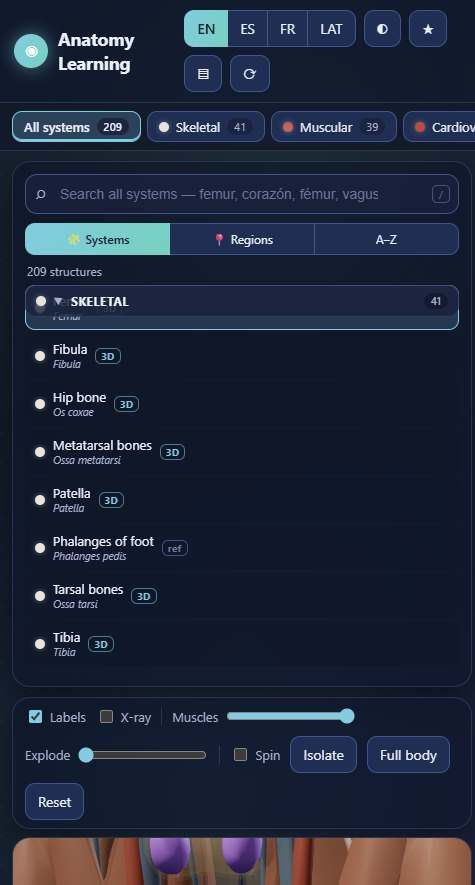
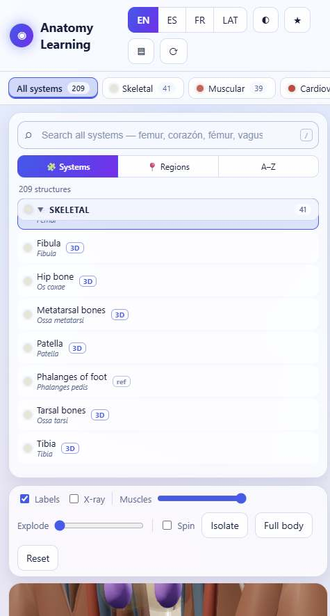
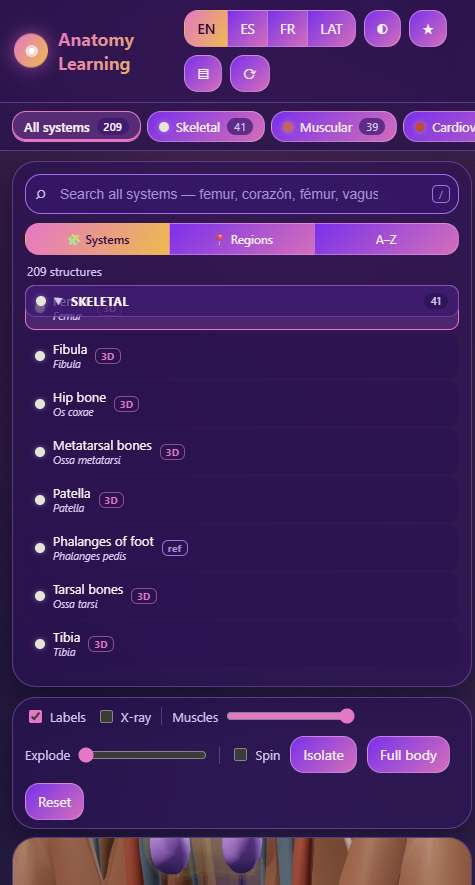

# Anatomy Learning — 3D Human Body Explorer

Free, open-source, interactive 3D anatomy for everybody. No account, no paywall, no ads — just a browser.

**→ Live demo:** [https://t2smart-ai.github.io/anatomy-learning-web/](https://t2smart-ai.github.io/anatomy-learning-web/)

  

## Features

- **Real 3D anatomy** — 2,234 meshes from the open BodyParts3D 4.0 dataset, rendered with Three.js
- **12 body systems** — skeletal, muscular, cardiovascular, nervous, respiratory, digestive, urinary, reproductive, lymphatic, endocrine, integumentary + sectional notes
- **209 structures** with names and descriptions in **English, Spanish, French and Latin** — and *nothing is a dead click*: every one of the 2,234 mesh areas selects its closest related card (159 cards carry real geometry, `3D` vs `ref` badges show which)
- **Easy browsing** — group by *system → subgroup* (Skull, Vertebrae, Thoracic cage, Upper limb…), by *body region* (Head & neck, Thorax, Abdomen, Limbs…), or flat A–Z; collapsible groups with counts; `3D` / `ref` badges show which entries have a model
- **Global search** — one search across all systems and all 4 languages, with instant results and keyboard navigation (`/` search · `↑` `↓` browse · `Enter` focus · `Esc` close)
- **Three polished themes** — Midnight (dark), Pearl (light) and Pop (playful), each with its own generated background texture; remembered per device
- **Resizable, maximizable viewer** — the 3D canvas fills its column by default; drag the edge handles or the grip under the canvas to resize, and hit **⛶** (or double-click the grip) for a huge focus view with the side panels hidden — `Esc` restores. Your layout is remembered per device
- **Living anatomy** — toggle **❤ Animate** (on by default): the heart beats at ~72 bpm, the lungs breathe at ~14 breaths/min, and emissive pulses travel along the arteries (blood flow), veins, nerves (signals) and gut (peristalsis)
- **Interactions** — orbit/zoom/pan, click-to-select with system-colored highlight, labels, isolate system, X-ray bones, muscle/skin transparency, exploded view
- **Quizzes** — *Find the word* and *Find the point*, scoring, streaks, mistake review
- **Flashcards & bookmarks** — saved on your device (localStorage)
- **Progressive loading** — the body shape appears after ~17 MB; remaining systems stream in the background or load on demand
- **Responsive** — 3-pane desktop layout, stacked mobile layout
- **Works without WebGL** — search, browser, details, flashcards and quizzes all still function

## Screenshots

| Midnight (dark) | Pearl (light) | Pop (playful) |
|---|---|---|
|  |  |  |

## Tech stack

Vanilla ES modules · [Three.js](https://threejs.org/) 0.160 (vendored in `src/vendor/`, MIT) · no build step, no backend, no tracker.

```
index.html            app shell (import map, SEO meta, 3-theme design system)
src/app.js            wiring: grouped browser, search, detail, quiz, bookmarks, themes, i18n
src/anatomy-data.js   structure database (EN/ES/FR/LA, systems, subgroups, regions, histology)
src/viewer3d.js       3D viewer + progressive per-system loader
src/quiz.js           quiz engine
src/storage.js        per-device persistence (localStorage)
src/themes/           generated per-theme background textures (SVG, from tools/make-theme-assets.mjs)
src/vendor/           Three.js + addons (pinned 0.160.0)
src/models/           BodyParts3D 4.0 meshes, one .bin.gz per system (CC BY 4.0)
tools/                repack-by-system.mjs — rebuilds per-system packs from the raw atlas
                      make-theme-assets.mjs — regenerate the theme background textures
legacy/perchance/     original Perchance generator files (archived, not used)
```

## Running locally

Any static file server works (ES modules require http://, not file://):

```bash
python -m http.server 8000
# or: npx serve .
```

Open http://localhost:8000 — first load fetches ~33 MB of compressed anatomy, then everything is cached by your browser.

## Deploying (GitHub Pages, free)

1. Create a GitHub repository and push this code.
2. Repository → Settings → Pages → Source: **Deploy from a branch** → Branch: `main` → Folder: `/ (root)`.
3. Wait ~2 minutes; the app is live at `https://<username>.github.io/<repo>/`.

No build step is needed — the site is plain static files.

## Licensing

- **Code**: [MIT License](LICENSE) — do what you want, credit kept.
- **3D models & atlas data**: [CC BY 4.0](https://creativecommons.org/licenses/by/4.0/) © The Database Center for Life Science (DBCLS), via the [human-atlas](https://github.com/ashemag/human-atlas) project. Attribution is mandatory and lives in [src/models/ATTRIBUTION.md](src/models/ATTRIBUTION.md) — keep it when redistributing the model files.
- Terminology follows standard public-domain anatomy (Nomina Anatomica); descriptions are original.

The app is **educational, not a clinical tool**.

## Contributing

See [CONTRIBUTING.md](CONTRIBUTING.md). Easy first issues: translations, more quiz distractors, accessibility improvements, per-system lazy-loading polish.

## Roadmap

- [ ] PWA / offline mode (service worker)
- [ ] UI chrome translations (structure names are already 4-language)
- [ ] 16-bit position quantization (~33% smaller models)
- [ ] Keyboard shortcuts for the 3D viewer
- [ ] Sectional slice viewer
